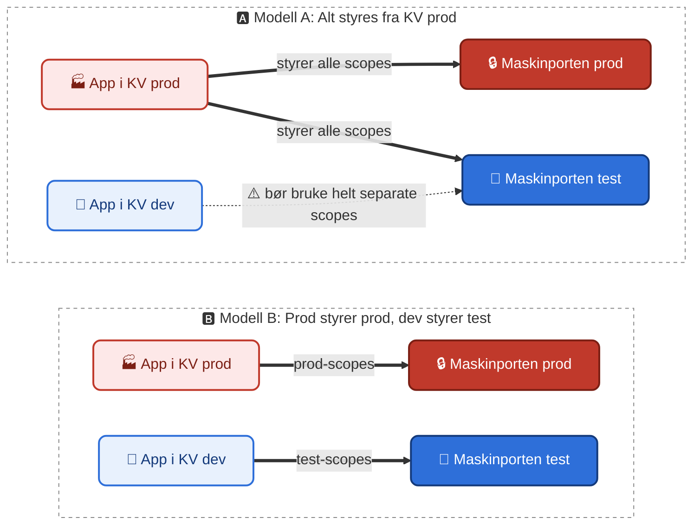

# Administrasjon av Maskinporten-scopes

[maskinporten-management](https://github.com/kartverket/maskinporten-management) er en tjeneste som lar
Kartverket-team administrere Maskinporten-scopes og hvilke organisasjoner som har tilgang til dem, uten selv å måtte
forholde seg til Digdir sitt API eller virksomhetssertifikatet som kreves for å kalle det. Tjenesten leveres som et
JSON-basert REST-grensesnitt på SKIP.

Fra prod-miljøene på SKIP er det mulig å administrere både Maskinporten sitt produksjonsmiljø og testmiljø. Dette
skjer med intern cluster-trafikk mot to ulike tjenester:
- Maskinporten sitt produksjonsmiljø: `http://maskinporten-management-prod.tilgangsstyring-maskinporten:8080`.
- Maskinporten sitt testmiljø: `http://maskinporten-management-test.tilgangsstyring-maskinporten:8080`.

I dev-miljøene er det kun administrasjon av Maskinporten sitt testmiljø som støttes, via intern
cluster-trafikk på `http://maskinporten-management-test.tilgangsstyring-maskinporten:8080`.

## 🤹 Velg én av to modeller
Maskinporten sitt prod-miljø kan kun nås fra prod-miljø på SKIP, men Maskinporten sitt testmiljø kan nås fra både prod-
og dev-miljø. Du bør bare la **ett** miljø styre hvert scope. Ellers kan prod- og dev-applikasjonen overstyre
hverandres scopes i Maskinporten test.

- **Modell A:** Prod-appen din er koblet til både Maskinporten prod og test, og styrer alle scopes i begge miljøer.
Dev-appen din bør bruke helt andre scopes i Maskinporten test, som ikke kolliderer med scopes prod-tjenesten din styrer.
Egner seg godt f.eks. dersom du skal lage et brukergrensesnitt for å administrere scopes, og du ikke vil at brukerne
skal måtte forholde seg til `dev`-miljø i Kartverket.
- **Modell B:** Prod-appen din er koblet til Maskinporten prod, og dev-appen din til Maskinporten test. Prod-scopes styres
fra prod, og test-scopes styres fra dev.

## 🔎 Hvordan bruke tjenesten?
Tjenestens API er dokumentert med OpenAPI [på kartverket.dev](https://kartverket.dev/catalog/default/api/maskinporten-management-rest-server-api/definition)
og [i GitHub-repo](https://github.com/kartverket/maskinporten-management/blob/main/maskinporten-management-rest-server/openapi.json).

### Administrere scopes
- `GET /api/scopes` - lister Kartverket sine scopes som den kallende applikasjonen har tilgang til
- `POST /api/scopes` - oppretter et nytt scope, basert på innhold i body
- `PUT /api/scopes?scope={scope}` - endrer et eksisterende scope, basert på innhold i body
- `DELETE /api/scopes?scope={scope}` - sletter et eksisterende scope

### Administrere konsumentens tilgang til scopes
- `GET /api/scopeaccess/orgs?scope={scope}` - lister hvilke organisasjoner som har fått tilgang til `scope`
- `GET /api/scopeaccess/scopes?orgnr={orgnr}` - lister hvilke av Kartverket sine scopes organisasjonen `orgnr` har
  tilgang til, filtrert på scopes den kallende applikasjonen har tilgang til
- `PUT /api/scopeaccess/{consumerOrgno}?scope={scope}` - gir organisasjonen `consumerOrgno` tilgang til `scope`, basert
  på innhold i body
- `DELETE /api/scopeaccess/{consumerOrgno}?scope={scope}` - fjerner organisasjonen `consumerOrgno` sin tilgang til
  `scope`

## 🔐 Tilgangsstyring til applikasjonen
Hvilke applikasjoner på SKIP som har lov til å kalle tjenesten, og hvilke scopes og operasjoner de har
tilgang til, styres av [`maskinporten-management-access-control`](https://github.com/kartverket/maskinporten-management-access-control).
Tjenesten bruker en innebygd mekanisme på SKIP kalt SPIFFE til å identifisere workloads, og validerer tilgang opp mot
reglene konfigurert i `maskinporten-management-access-control`.

Tilgang til scopes defineres med en kombinasjon av:
- `prefix`, hvis du vil administrere en gruppe scopes, f.eks. `kartverk:matrikkel:`. Prefikser må alltid slutte på `:`,
   `/` eller `.`
- `exact`, hvis du vil administrere spesifikke scopes uten noen naturlig prefiks, f.eks. `kartverk:dokumentbestilling`

I tillegg må du spesifisere hvilke **operasjoner** (`actions`) hver workload har lov til å utføre:

| Action              | Gir tilgang til                                | Rotsti             | HTTP-metoder                      |
|---------------------|------------------------------------------------|--------------------|-----------------------------------|
| `scopes/read`       | Hente ut informasjon om Kartverket sine scopes | `/api/scopes`      | `GET`                             |
| `scopes/write`      | Opprette, endre eller slette scopes            | `/api/scopes`      | `POST`, `PUT`, `PATCH`, `DELETE`  |
| `scopeaccess/read`  | Hente ut informasjon om konsumenter av scopes  | `/api/scopeaccess` | `GET`                             |
| `scopeaccess/write` | Legge til eller fjerne konsumenter for scopes  | `/api/scopeaccess` | `POST`, `PUT`, `PATCH`, `DELETE`  |

Det viktigste er at du tar stilling til hvorvidt din workload trenger `scopes/write`- og/eller
`scopeaccess/write`-tilgang.

For å gi din applikasjon tilgang:
1. **Åpne en pull request** mot [`maskinporten-management-access-control`](https://github.com/kartverket/maskinporten-management-access-control),
   der du legger inn eller utvider din workload (`<namespace>/<service-account>`) i `data.workload_access` for
   miljøet(ene) (`dev`, `prod`, eller begge) du trenger tilgang i, med hvilke `actions` og scopes (eksakt og/eller
   prefiks) du trenger.
2. **Team Tilgangsstyring reviewer, merger og deployer pull requesten.** Når den er deployet har din workload
   tilgang til å utføre de gitte operasjonene på de gitte scopene i de valgte miljøene.

Du kan bruke Copilot-skillet `maskinporten-scope-access-pr`
(`.github/skills/maskinporten-scope-access-pr/SKILL.md` i `maskinporten-management-access-control`) til å
forberede PR-en, eller redigere `opa/data/<env>/workload_access/data.json`-filene manuelt og åpne en PR på vanlig
måte.
